# The founder's own sites: what makes them good, and what A Story still lacks

Research note, 17 October 2026. The founder holds the A Story web app to the standard of five sites they have built: Project Reboot (journal.gbaonvo.com), the personal website (gbaonvo.com), Kiyo, Shiori and the A Story marketing site (astoryapp.com). This note looks at each one in turn, pulls out the ideas that recur across all five, compares them with the web app as it ran on http://localhost:5180 tonight, and ends with proposed additions to `docs/BAOS-STANDARD.md`.

Where `BAOS-STANDARD.md` or `DESIGN.md` already covers something (cloth and sheet, running head, ribbon, "Dear family,", the dog on the sign-in plate, quiet small print, house easings), this note does not repeat it. It looks for what is missing.

**How this was checked, and what wasn't.**

- **Project Reboot.** Its built `dist/` was served locally on port 5191 and seeded with the project's own clearly labelled SAMPLE data (from `tests/visual.mjs`). This is not the live site, which sits behind Cloudflare Access.
- **Kiyo and Shiori.** Their `dist/` builds were served on ports 5192 and 5193. Each was opened as a guest in a fresh headless profile, so their pages show the first-day state, with no progress data.
- **gbaonvo.com and astoryapp.com.** Captured live with headless Playwright (chromium-1243) and read with WebFetch.
- **Screen sizes.** Screenshots were taken at 1440×900, 1920×1000 and 390×844. Full-page captures used reduced motion, so content revealed on scroll is visible.
- **The web app.** Read in my own browser-pane tab at 1440×900 and 390×844, using text and DOM measurements plus the pane's small screenshots. Nothing was written, and the founder was not signed out. For the signed-out pages, the existing captures in `docs/audit/shots/` were used.
- **Not verified:** 1366, 2560 and zoomed-out views of the web app, any hover or pointer delight, and the web app's pages while other builder agents were changing them.

All screenshots are in `docs/research/founder-sites/`.

---

## 1. Project Reboot (journal.gbaonvo.com)

**What it is.** A private discipline-and-reflection app for one person, built from the founder's handwritten May 2026 board of 36 commitments. It has five places: Today, the Reboot Board, the Journey, the Journal and Review. It is local-first, with no account, and stays private behind Cloudflare Access.

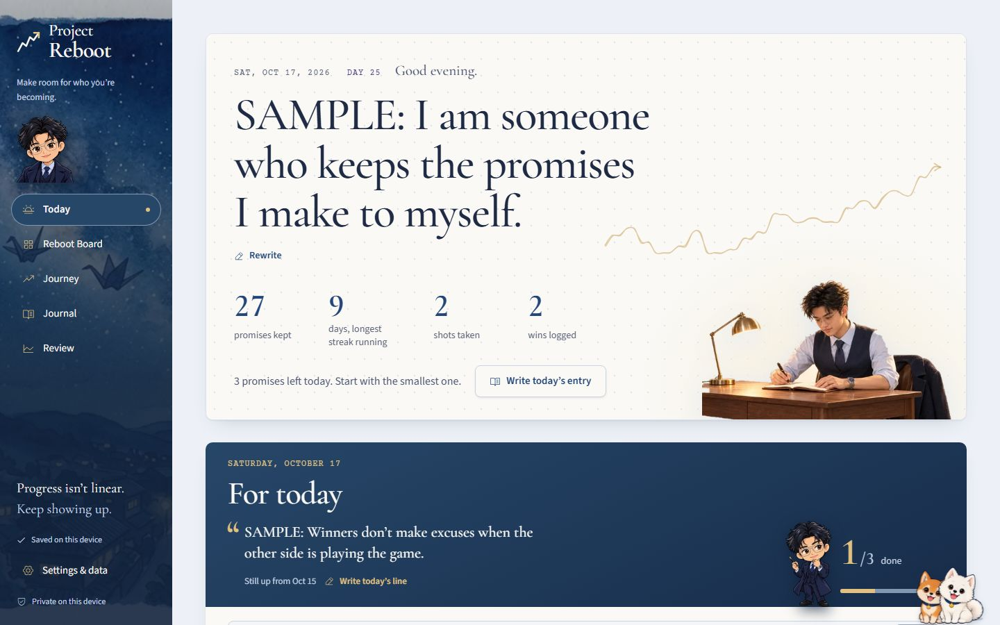
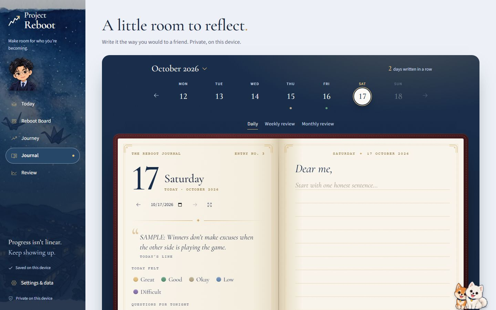
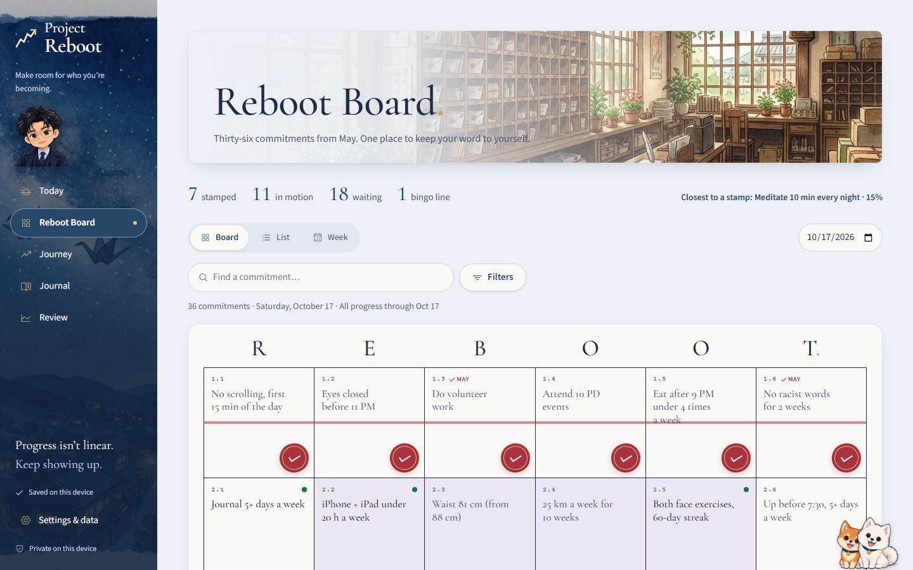
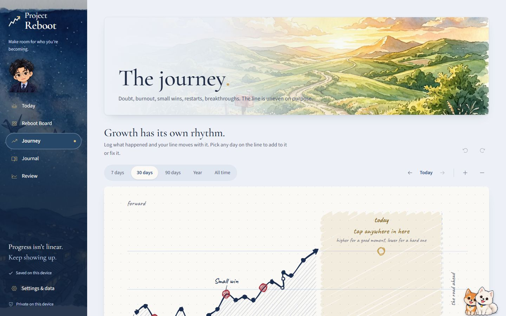
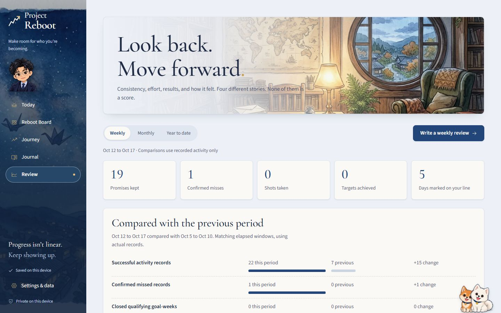
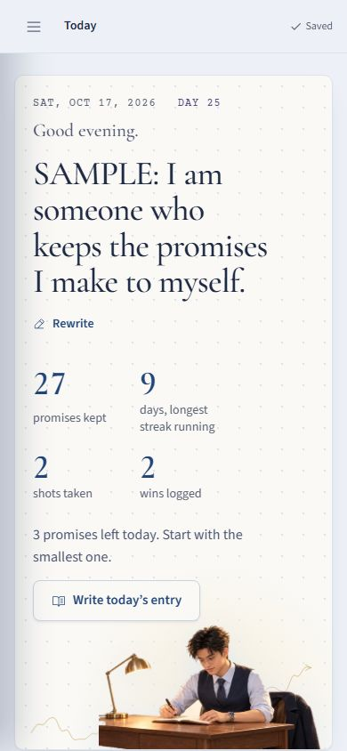

Also captured: `reboot-today-1920.jpg`, `reboot-journal-1920.jpg` and `reboot-journal-390.jpg`.

**The devices that make it work.**

- **Every place has its own illustrated scene.** Each page opens on a different watercolour place:
  - the Board is a post-office sorting room;
  - the Journey is a road winding through a valley at dawn;
  - Review is a study with a round window and a reading chair;
  - Today has the founder's own character writing at a desk under a brass lamp.

  The title sits over the scene's pale left side. You always know which room you are in, and every room is a different one. A Story uses the same cloth band on every page.
- **A sentence of identity, set huge.** Today's headline is not a greeting. It is the person's own sentence ("I am someone who keeps the promises I make to myself"), in a 60px serif, with "Rewrite" under it as a quiet text action. The page leads with the person's words, not the app's.
- **Numbers as words.** "27 promises kept · 9 days, longest streak running · 2 shots taken · 2 wins logged". The numerals are large serif in navy, the labels sit below them in grey sentence case, and nothing is boxed. On the Board: "7 stamped · 11 in motion · 18 waiting · 1 bingo line", and on the right "Closest to a stamp: Meditate 10 min every night · 15%". Every count is attached to a next step.
- **The next step is small and said once.** "3 promises left today. Start with the smallest one." sits beside a single outlined button, "Write today's entry".
- **A signature dot.** Page titles end in a maize period ("Reboot Board.", "The journey.", "A little room to reflect."). It is the same move as the brass period of the personal site's GB mark.
- **The journal is a real object.** It is an oxblood leather book with gold stitching, open on a navy desk, with a silk ribbon hanging from the gutter. The left page holds the date masthead ("17 Saturday"), the entry number ("ENTRY NO. 3"), today's line as an epigraph, mood swatches, "Questions for tonight" numbered i–iv and "Count it" as a wax seal. The right page is only for writing: "Dear me," … "Yours, me". Its folio reads "0 words · nothing written yet". The week strip runs across the top, with today ringed in gold. A Story's writer already borrowed most of this.
- **The pocket pups.** A shiba and a samoyed live on the bottom edge of every page. They trot after you, cover their eyes while you write ("Not peeking. Promise."), tilt their heads while you type, jump for a kept promise and fall asleep when you step away. Tap one and it reminds you of a real entry from your proof file (README). They are hidden on phones and under reduced motion. The founder's design doc says the pets "ignore the pointer, so they never block a click."
- **A hand on the paper.** The Journey chart is drawn like a sketchbook: rough.js pencil lines, hatching, a highlighter on today, Caveat handwriting ("tap anywhere in here", "the road ahead"). Its rule is: "The Honest Line Rule. Preserve the distinction between recorded and missing Journey days."
- **Small print with personality.** The sidebar foot reads "Progress isn't linear. Keep showing up." in the serif, then "✓ Saved on this device" and "Private on this device". The footer reads "Project Reboot … A personal commitment. An ongoing story."
- **Motion as a programme.** Each page title rises word by word, and the content settles in. On the first visit of the day, the Today greeting writes itself letter by letter. Checked to-dos glide to the bottom (Flip). The Board deals its 36 squares from the outer ring to the centre, then presses its seals. Picking a day in the Journal turns the page and writes "Dear me," in with the pen. Review numbers count up. Everything runs through `gsap.matchMedia()`, so "with Reduce Motion on the UI simply appears" (README).
- **Hidden delight for the regular.** Type "reboot" anywhere for a surprise, and hovering the logo redraws it.

**In the founder's words** (Reboot `DESIGN.md`, `README.md`):

- "Don't replace the ruled workspace with a grid of decorative statistic cards."
- "Don't fill the Journey chart with fabricated activity or smooth its jagged segments."
- "Nothing is counted that you did not record."
- "Prefer rules and tonal grouping; reserve shadows for the selected segment and mobile navigation."

---

## 2. The personal website (gbaonvo.com)

**What it is.** An editorial portfolio in navy, warm paper and brass: "From silicon to strategy." It has Home, A Story, Work (with eight case studies), About, Archive and Contact, plus "The Path, So Far", a twelve-chapter flipbook of the founder's life.

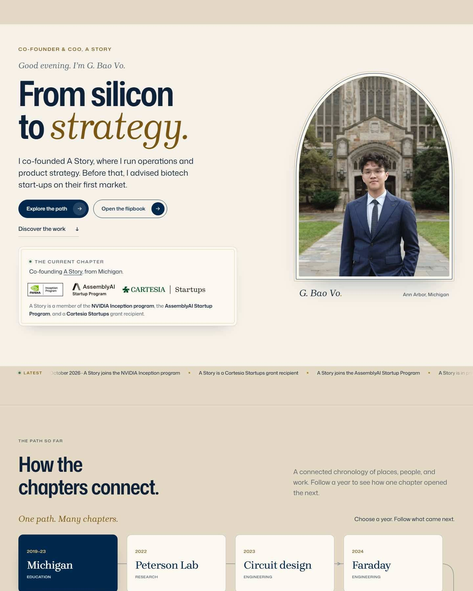
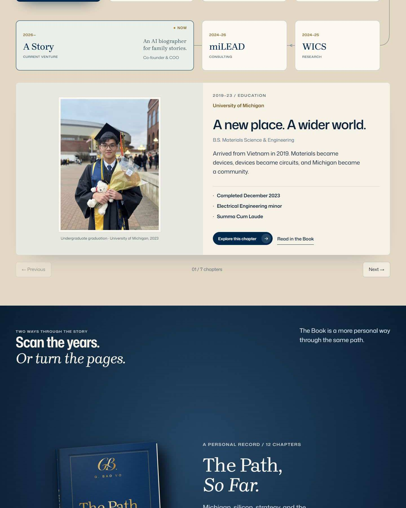
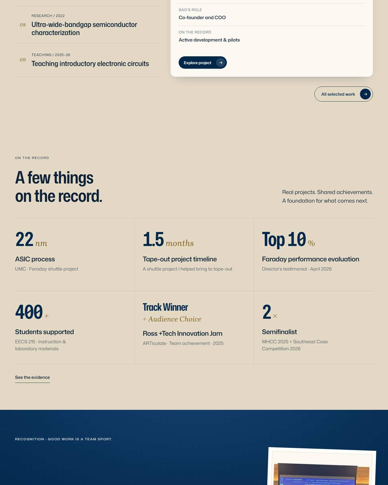
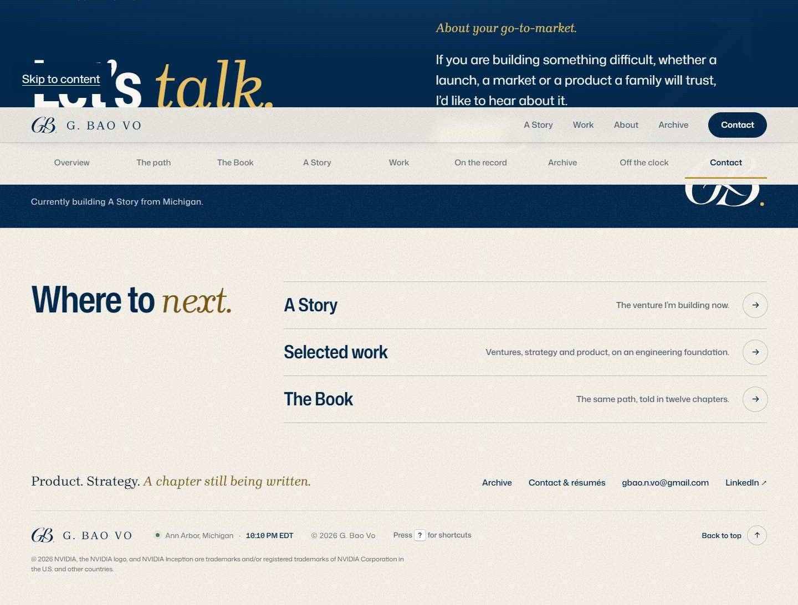
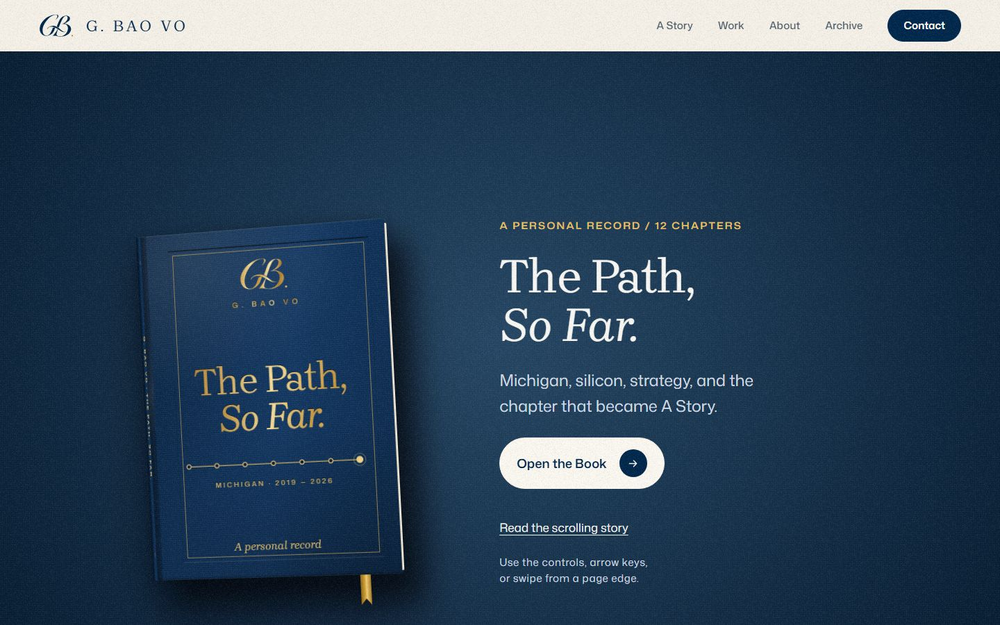
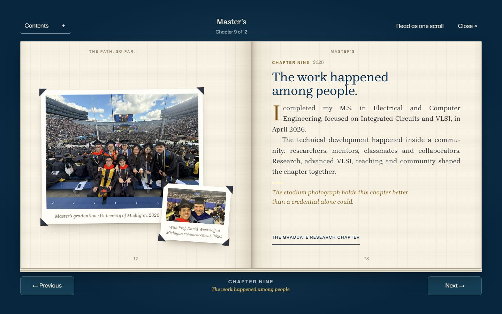

Also captured: `gbaonvo-a-story-1440.jpg` and `-1920` and `-390`, `gbaonvo-about-1440(-full)`, `gbaonvo-work-1440(-full)`, `gbaonvo-contact-1440(-full)`, `gbaonvo-home-1440-full.jpg`, `gbaonvo-home-1920.jpg` and `-390`.

**The devices that make it work.**

- **A first-visit intro, once per session.** A navy cover shows a chip die with seven chapter tiles while a gold path traces through them. It has "SKIP INTRO" and can be skipped by a click or Esc. Then the hero arrives.
- **The serif turn.** The headline is a condensed sans with one word turned into brass italic serif: "From silicon to *strategy.*", "Where to *next.*", "Let's *talk.*", "Scan the years. *Or turn the pages.*" One emphasis per headline, always the last word, always the human word.
- **The greeting knows the hour.** "Good evening. I'm G. Bao Vo." sits in serif italic above the headline. The footer carries a live local clock ("10:10 PM EDT"), "Ann Arbor, Michigan" with a green dot, and "Press ? for shortcuts".
- **The portrait in an arch.** The hero photograph sits in an arched mat with a fine navy and brass rule. Under it are the name in serif, a brass period and the place in small grey type. Shiori and Kiyo use the same arch for their companions (see below).
- **"The current chapter."** A small card under the actions says what is happening now: "Co-founding A Story, from Michigan."
- **The path as one connected chronology.** Seven chapter tiles snake across the page on a single rail. The current one is double-width and carries a "● NOW" marker. Choosing a year opens one chapter below the tiles. That chapter shows:
  - one large print with a caption;
  - the year and role as metadata;
  - a headline that is the chapter's idea ("A new place. A wider world.");
  - two sentences;
  - three plain facts;
  - one primary action and one text link ("Explore this chapter", "Read in the Book");
  - "← Previous · 01 / 7 chapters · Next →" below.
- **"On the record."** Six numbers in a ruled grid with the unit in brass italic serif: "22 *nm*", "1.5 *months*", "Top 10 *%*". Each has a plain label and a quiet source line ("Director's testimonial · April 2026"), followed by "See the evidence".
- **The Book.** On the Book's page there is nothing else: a navy cloth book with a gold-foil title and a ribbon, "A PERSONAL RECORD / 12 CHAPTERS", "The Path, *So Far.*", one cream pill ("Open the Book"), one text link ("Read the scrolling story") and one line teaching the interaction: "Use the controls, arrow keys, or swipe from a page edge." Inside each spread:
  - a running head on each page and folios;
  - the chapter number in words ("CHAPTER NINE 2026");
  - a drop cap;
  - prints tipped in with black photo corners, two overlapping at different angles, with serif-italic captions;
  - a closing line in brass italic, the chapter's coda: "The stadium photograph holds this chapter better than a credential alone could."
  - The bar below repeats the chapter in words, and there is a Contents overlay.
- **Every page ends with "Where to next."** A big two-tone headline on the left. On the right, three ruled rows, each with a title in the display face, one line in grey and a round arrow button.
- **Grounds alternate.** Cream, then sand, then navy cloth bands, so the long home page (15 screens at 1440) reads as chapters rather than one sheet.

**In the founder's words** (briefs in `Personal Website/v2-planning/`):

- "Use four levels consistently: LEVEL 1 — PRIMARY IDEA … LEVEL 2 — KEY TAKEAWAY … The thing a skimming visitor should remember … LEVEL 3 — SUPPORTING EXPLANATION … LEVEL 4 — METADATA … Do not let metadata dominate."
- "Every section should make it obvious: WHAT IS THE MAIN IDEA? WHAT EVIDENCE SUPPORTS IT? WHAT CAN I DO NEXT?"
- "Each composition should usually have only 1–3 emphasized concepts."
- "Use arrows only when they communicate meaningful direction." Keep them for Previous/Next and external links; "REMOVE arrows from: tabs, filters".
- "There are still too many disclaimers … Create ONE disclaimer language system."
- "Does the page have one or two moments that feel specific to Bao? If not: redesign."
- On empty space in the Book: "enlarge the main photograph … add one pull quote … add contextual caption / date … Do NOT fill space with paragraphs. Do NOT add decorative filler."
- "there must NEVER be internal vertical/horizontal scrollbars inside individual Book pages."
- On routes: "No route should feel … like a default content page … like documentation … like the design budget ran out after Home."
- On how it should feel: "premium, authored … warm, human … visually rich … easy to read … It should NOT feel … generic, templated … like a SaaS landing page … overly sparse … overly dense … tiny."

---

## 3. Kiyo 清 (Mandarin)

**What it is.** A characters-first Mandarin study app, "Mandarin, crystal clear.", with the companion Sayo. It uses a midnight-navy "Night Study" palette with pale blue actions. Kiyo and Shiori are twins: "Same structure, different costume" (`SHARED-SPEC.md`).

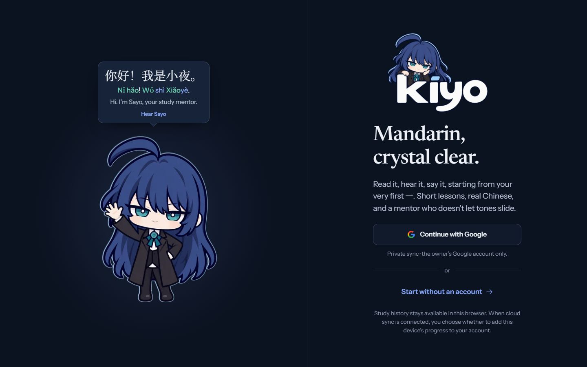
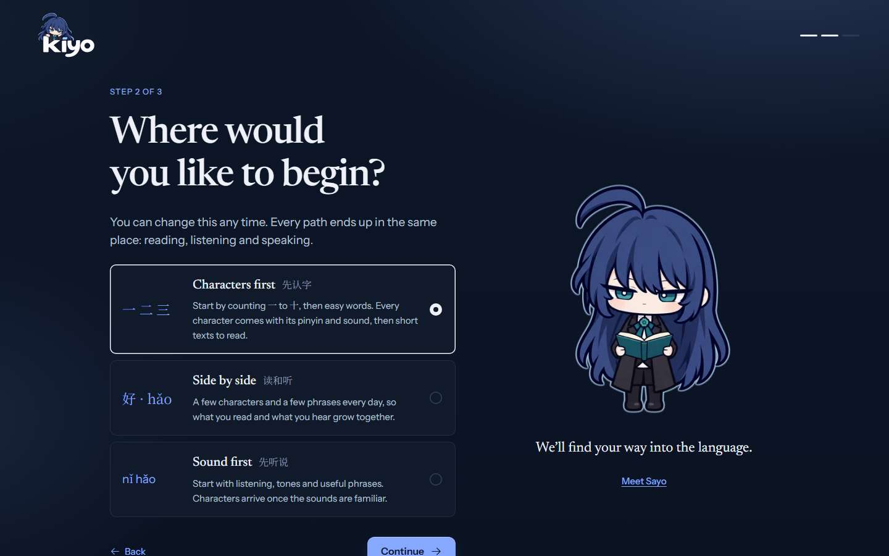
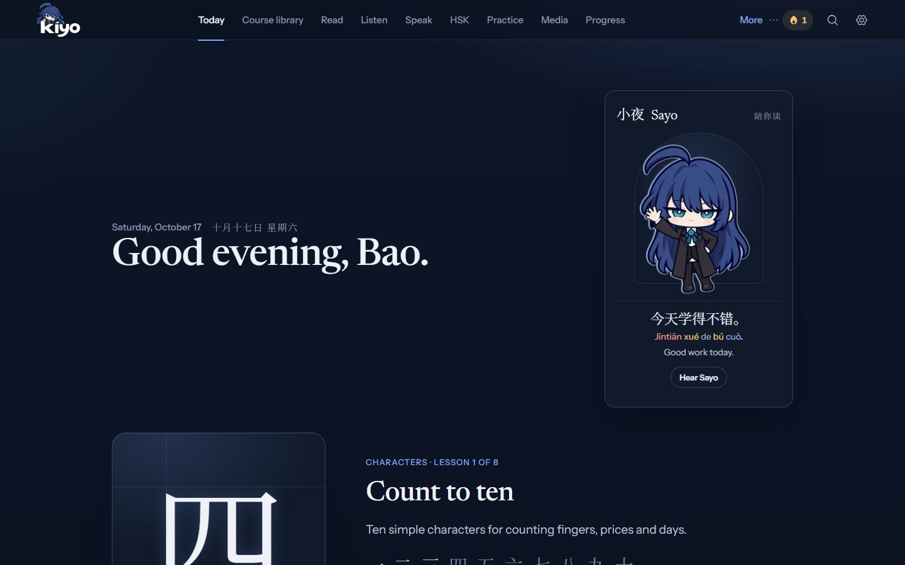
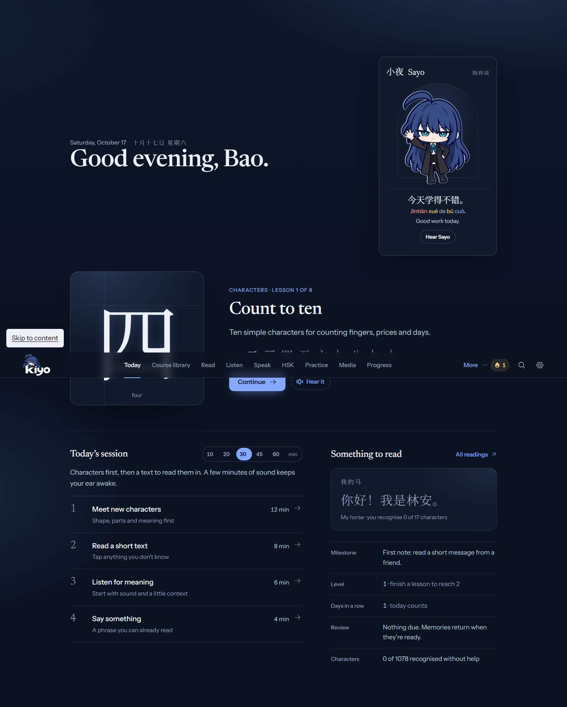
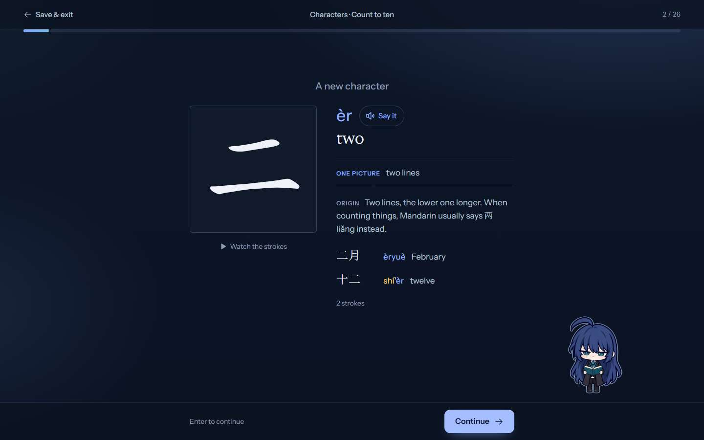
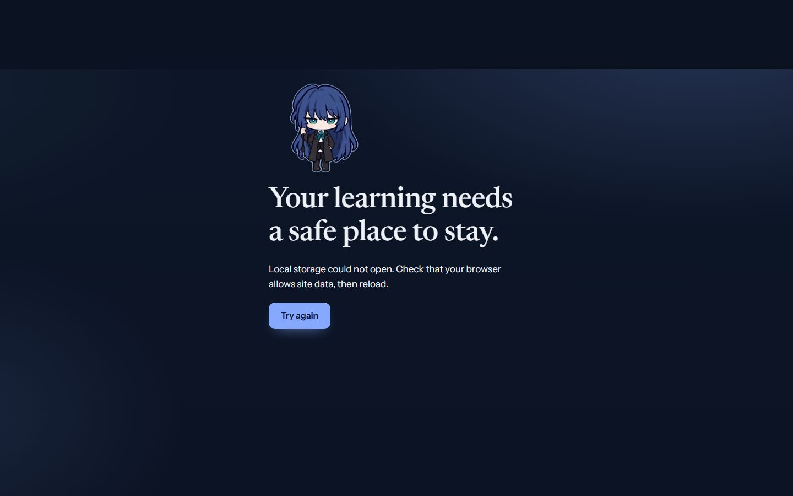

Also captured: `kiyo-today-1920.jpg`, `kiyo-today-390.jpg` and `kiyo-quiz-1440.jpg`.

**The devices that make it work.**

- **A paired welcome.** On the left, the companion with a speech bubble in three tiers: "你好！我是小夜。", the pinyin in tone colours, "Hi. I'm Sayo, your study mentor.", and then "Hear Sayo". On the right, the logo, a two-line serif headline, one paragraph, one primary action and a quiet "Start without an account →".
- **Onboarding as three big choices, each with a specimen.** "Where would you like to begin?" has three cards. Each card shows:
  - a specimen on the left (一 二 三, 好 · hǎo, nǐ hǎo);
  - a name and its Chinese label ("Characters first 先认字");
  - two lines of description;
  - a radio.

  Above the cards is "STEP 2 OF 3". On the right, Sayo reads a book over the line "We'll find your way into the language." There are progress dashes at the top right.
- **Today answers "what next?" with one lead.** It starts with "Good evening, Bao." and the date in English and Chinese. Below that:
  - The lead lesson is a large specimen square on a faint 米字格 grid, beside "Count to ten" and a one-line purpose ("Ten simple characters for counting fingers, prices and days."). Then comes a preview row of the characters, and Continue plus Hear it.
  - **Today's session** is a numbered plan with a 10/20/30/45/60-minute selector and one line of why. Its rows are "1 Meet new characters · Shape, parts and meaning first · 12 min →", and so on.
  - **Something to read** is one teaser, followed by **a ruled stats table in plain words**: "Milestone: First note: read a short message from a friend", "Level: 1 · finish a lesson to reach 2", "Days in a row: 1 · today counts", "Review: Nothing due. Memories return when they're ready.", "Characters: 0 of 1078 recognised without help".
- **The companion panel.** Sayo stands in an arch inside a quiet panel: "小夜 Sayo · 陪你读", her line in three tiers and "Hear Sayo".
- **Focus mode.** No site navigation. There is a 60px bar ("← Save & exit", the lesson title in the centre, "2 / 26"), a 3px progress rule, a centred 720–760px task column, "Enter to continue" and one Continue button. The specimen is drawn stroke by stroke. Sayo sits in her own column, so "she can never cover an answer" (`SHARED-SPEC.md` §4).
- **A designed failure.** When local storage cannot open, the page is not a browser error. It shows Sayo, the headline "Your learning needs a safe place to stay.", one sentence of cause and remedy, and "Try again".

**In the founder's words** (`SHARED-SPEC.md`, owner-approved):

- "Never pin a short task to the top and leave a blank screen below it."
- "**One coloured plane per screen** … Everything else is paper, ink and small accents."
- "Copy is short and precise, in the mascot's voice. Don't repeat a cute word on the same screen."
- "Headings are upright (roman), never italic. Don't invent metrics."
- "Never use a stern or arms-folded pose for a correct answer."

---

## 4. Shiori 栞 (Japanese)

**What it is.** Kiyo's twin, with the companion Violetto. Blue framing on cool letter paper makes "Japanese study feel like correspondence."

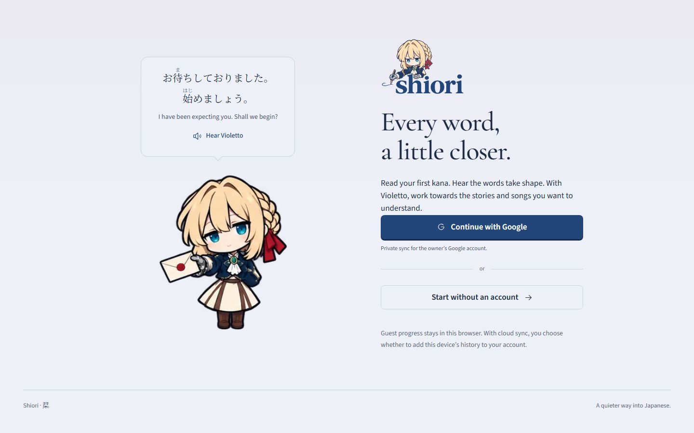
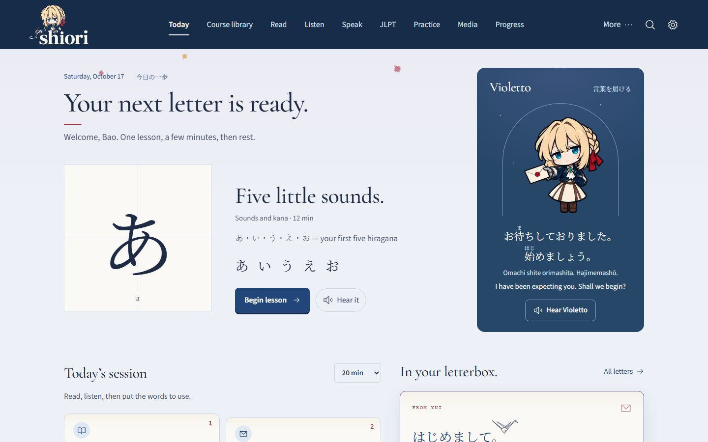
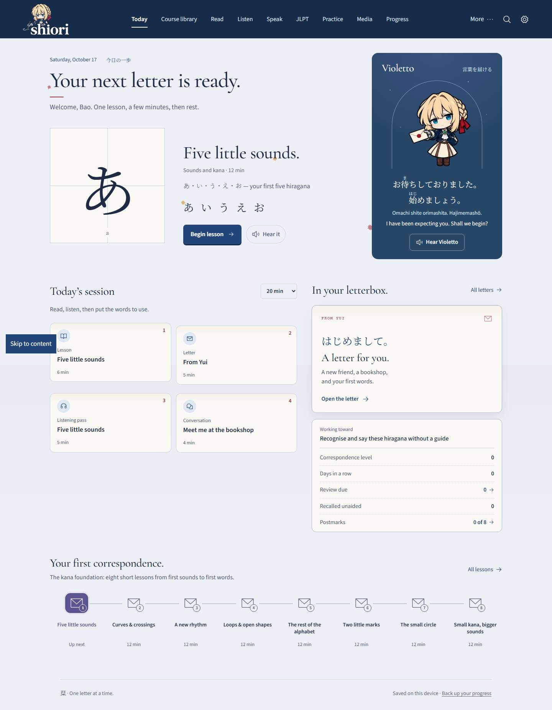
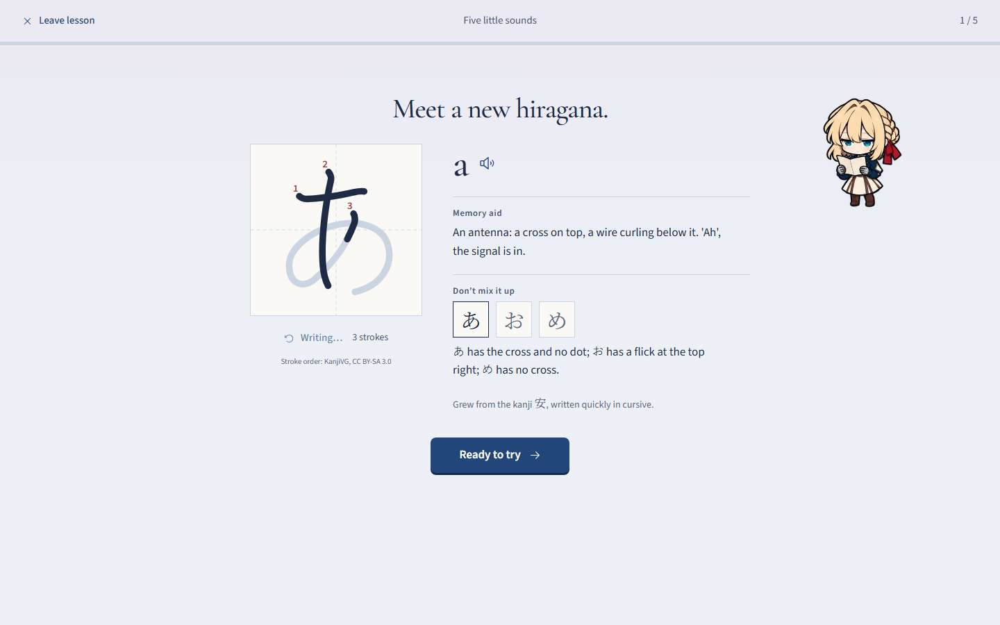
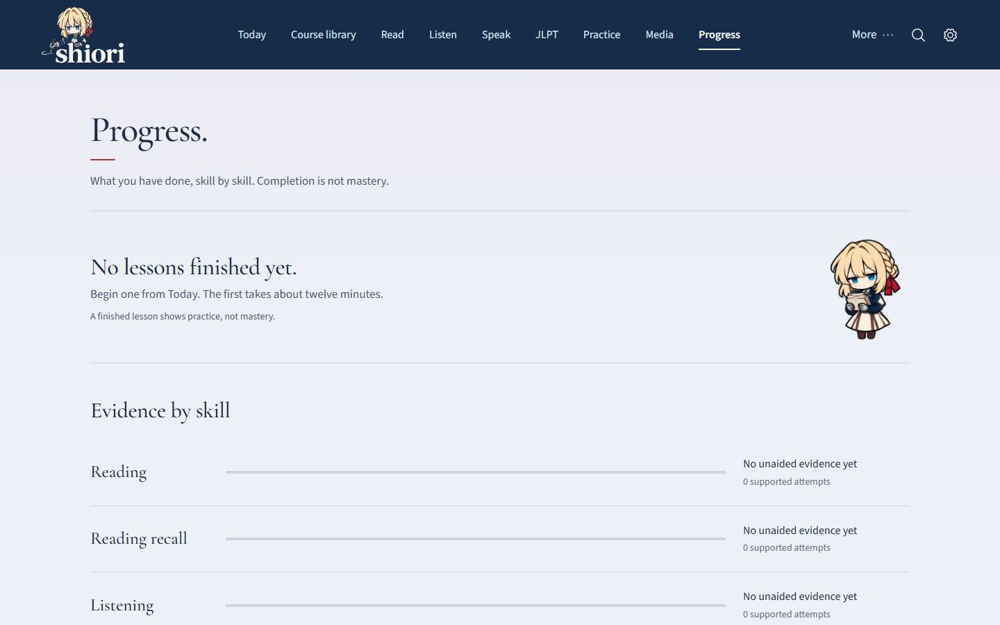

Also captured: `shiori-today-1920.jpg`, `shiori-today-390.jpg`, `shiori-read-1440.jpg` and `shiori-voice-1440.jpg`.

**The devices that make it work.**

- **The whole app is one metaphor, carried into every word.** Today says "Your next letter is ready." The secondary column is "In your letterbox." and the path is "Your first correspondence.", eight envelopes with "Up next" under the first. The rewards are postmarks. The footer reads "栞 · One letter at a time." and "Saved on this device · Back up your progress".
- **Page titles are plain nouns with a period**, with a short ribbon-red rule under them: "Progress.", "Violetto's voice.", "Reading."
- **A lead on a manuscript grid.** あ sits in a 300px 原稿用紙 square beside "Five little sounds.", "Sounds and kana · 12 min", a preview row (あ い う え お), "Begin lesson →" and "Hear it". There is no card around it: "Shiori's ivory card wrapped around a pale-blue box (a card inside a card) is removed."
- **Empty states with a pose and a time.** Progress, with nothing done, reads: "No lessons finished yet. Begin one from Today. The first takes about twelve minutes. A finished lesson shows practice, not mastery." Violetto stands beside it holding a letter.
- **Honest evidence.** The lead on Progress is "Evidence by skill", and every row reads "No unaided evidence yet · 0 supported attempts". The rule is "Completion is not mastery."
- **Teaching beside the specimen.** A kana is drawn stroke by stroke with ribbon-red stroke numbers. Beside it are a memory aid, "Don't mix it up" with look-alikes (あ お め) and one line of origin ("Grew from the kanji 安, written quickly in cursive.").
- **Playful touches that can be switched off** (`src/playful.ts`). A paper crane follows the pointer. Clicks on empty paper leave a postmark (済 〒 栞 届 便). Violetto watches the pointer. "Today follows the clock and the season": tonight, autumn leaves drift across Today. All of it is "decoration over the real interface: fixed overlays with pointer-events none … Skipped entirely when the device asks for reduced motion or the learner turns it off."

**In the founder's words** (`SHIORI-DIRECTION.md`, `Japanese/DESIGN.md`):

- "**Allow one coloured plane per screen.**"
- "Dress the app the way Violet is dressed": a navy coat for the frame, an ivory blouse for reading paper, "jewellery-sized accents only".
- "Precise and plain … One 'little' per screen at most."
- "Don't present guided answers, correspondence levels, completion counts or roadmap labels as proven fluency."
- "Don't let companion art, postal ornament or continuous animation obstruct reading and retrieval."

---

## 5. The A Story marketing site (astoryapp.com)

**What it is.** The public site for A Story. Its Home page runs from the hero through what gets lost, the family book, the sample books, the calls, the witnesses and the family loop, to the price ladder and a closing invitation. It also has /samples, How it works and Pricing.

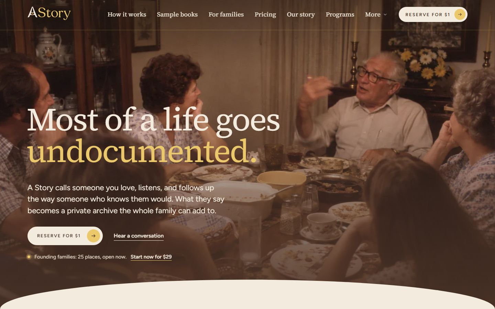
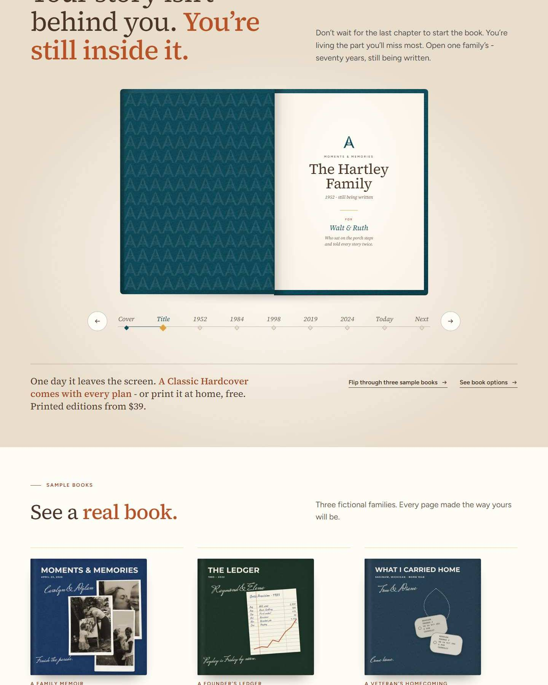
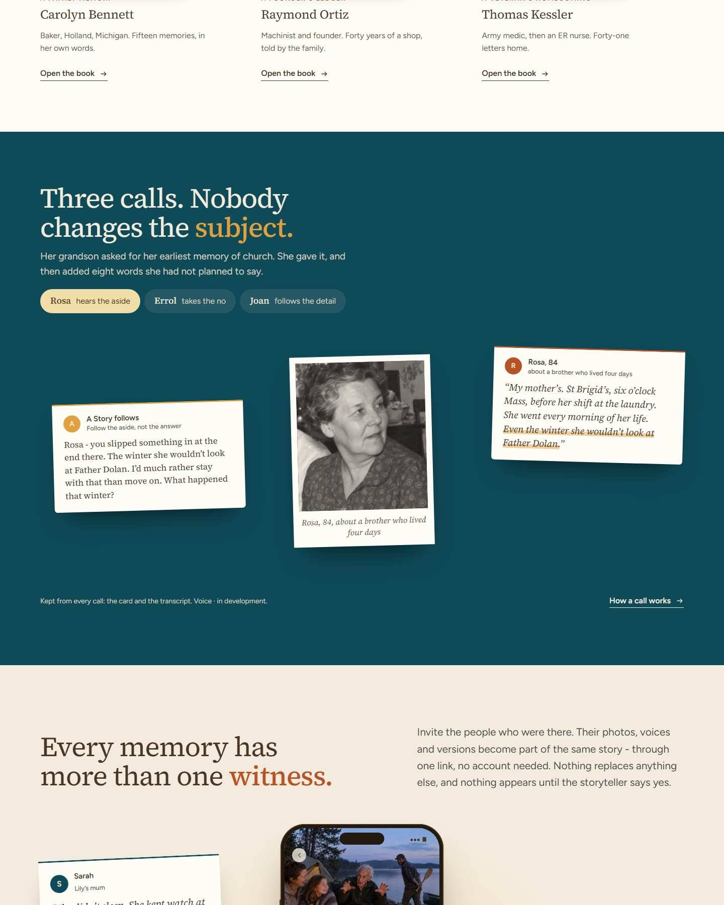
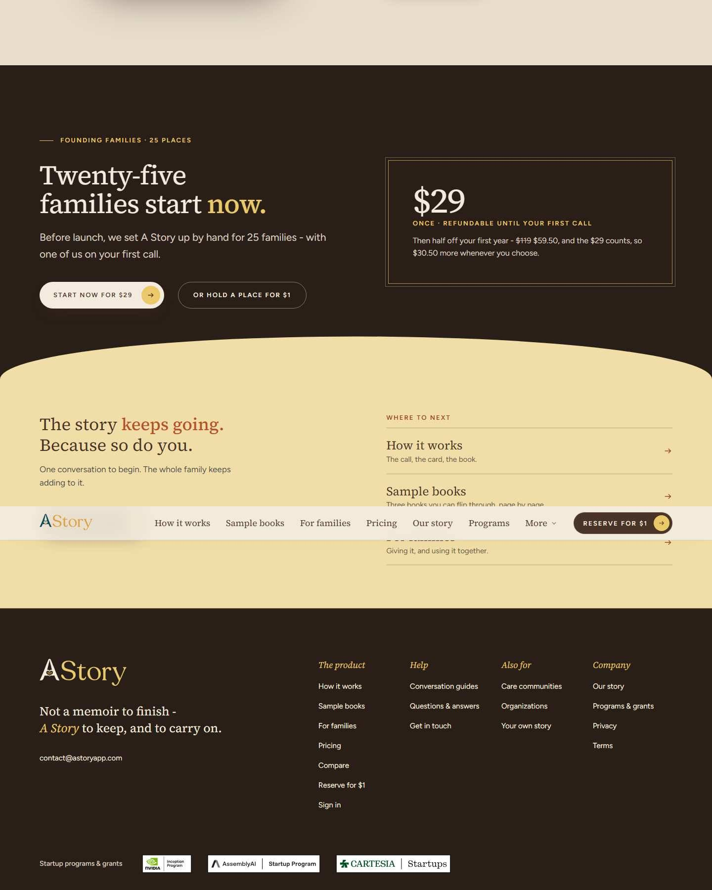
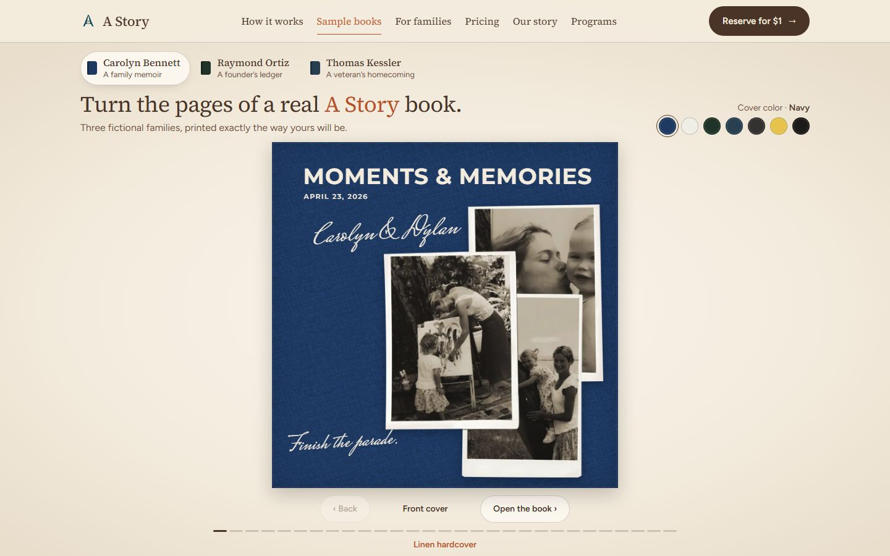
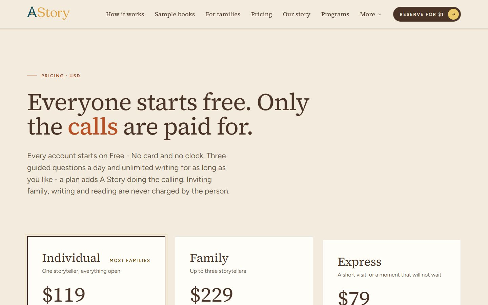

Also captured: `astory-home-1440-full.jpg`, `astory-home-1920.jpg` and `-390`, `astory-samples-1920.jpg` and `-390`, `astory-how-it-works-1440(-full)` and `astory-pricing-1440-full.jpg`.

**The devices that make it work.**

- **A real photograph under the opening line.** "Most of a life goes *undocumented.*" is set over a 1970s family dinner, with gold on the last word. The cream ground then rises over the photograph in a wide arc, the "rising cream edge".
- **Stacked prints with handwritten captions** ("Walt & Ruth · 1951"). One print is in front and two lean behind it.
- **The book with a year scrubber.** Under the open book is a rail: "Cover · Title · 1952 · 1984 · 1998 · 2019 · 2024 · Today · Next". You scrub a family's life by year, not by page number.
- **Chips with a name and a verb.** "**Rosa** hears the aside · **Errol** takes the no · **Joan** follows the detail". Each chip names a person and says what happens.
- **The words they let slip, highlighted.** In Rosa's quote, one phrase carries a gold marker underline: "*Even the winter she wouldn't look at Father Dolan.*" That phrase is what the page wants you to remember.
- **Grounds change by chapter.** Ivory, then sand, then teal (one teal scene per page, reserved for the calls), then chocolate, then butter for the close.
- **The idea before the plans.** Pricing opens with "Everyone starts free. Only the calls are paid for." The plans come after. Prices are said once, on one ladder.
- **The close.** "The story *keeps going.* Because so do you." sits on a butter ground, beside the same "Where to next" index the personal site uses.

**In the founder's words** (`landing-page-publish/design.md`, and rulings recorded in memory):

- "No single element may be taller than the window at 1280×720."
- "Home sections are a headline, one line, a picture and a link; the detail lives on the topic's own page."
- "Things that are not links do not look like buttons."
- "Nothing sticky may cover content the reader has not chosen."
- On text-heavy pages: "all text, I can't retain anything". The founder asked for things you can play with instead: "hover-to-shuffle prints, playable call 'like a video', a book you open".

---

## 6. The founder's philosophy, distilled

Twenty-six principles that recur across these sites. Each names its evidence.

1. **Every place is a different room.** Each page has its own scene or object, not the same banner. *Reboot:* the post office (Board), the valley road (Journey) and the study (Review). *Personal site:* the Book page is only the navy book. *Marketing:* every Home section has a different composition.
2. **One metaphor, carried into every word.** *Shiori:* letter, letterbox, correspondence, postmarks, "One letter at a time." *Reboot:* a journal with "Dear me", a ribbon and "Count it" as a wax seal. *Personal site:* chapters, "The Path, So Far", "A chapter still being written."
3. **Lead with the person's own sentence.** *Reboot Today:* the identity sentence is the headline. *Marketing:* Rosa's words set large. *Personal site:* "Good evening. I'm G. Bao Vo."
4. **Four levels of hierarchy, and the second one is "what should I remember?"** *Personal site brief:* "LEVEL 2 — KEY TAKEAWAY … The thing a skimming visitor should remember." *Book:* each chapter ends with a brass coda line. *Marketing:* the gold-highlighted phrase in Rosa's quote.
5. **One emphasis per headline, on the human word.** *Personal site:* "From silicon to *strategy.*", "Where to *next.*" *Marketing:* "Most of a life goes *undocumented.*" *Brief:* "Each composition should usually have only 1–3 emphasized concepts."
6. **A signature full stop.** *Reboot:* the maize period on page titles. *Personal site:* the brass period of GB ("it stands for 'now'"). *Shiori:* "Progress." with a ribbon rule.
7. **Today answers "what next?" with one lead, then a short numbered plan with minutes.** *Kiyo and Shiori Today:* the lead lesson, then "Today's session" with 1–4, minutes and →. *Reboot:* "3 promises left today. Start with the smallest one."
8. **Status is a ruled table in plain words, not tiles.** *Kiyo:* "Review: Nothing due. Memories return when they're ready." *Reboot DESIGN.md:* "Don't replace the ruled workspace with a grid of decorative statistic cards."
9. **Numbers carry a unit and a source, or they don't appear.** *Personal site:* "22 *nm*" with "UMC · Faraday shuttle project". *Reboot:* "Nothing is counted that you did not record." *Shiori and Kiyo:* "Don't invent metrics."
10. **Honest evidence, said kindly.** *Shiori:* "Completion is not mastery." "No unaided evidence yet." *Reboot:* the Honest Line Rule. *Kiyo:* "0 of 1078 recognised without help."
11. **Every page ends with "Where to next."** Three ruled rows: a title, one line and a round arrow. *Personal site:* the Home and Contact closes. *Marketing:* the Home close.
12. **Previous and Next with names, not just arrows.** *Personal site:* "← Previous · 01 / 7 chapters · Next →" and "CHAPTER NINE · The work happened among people." *Book:* Contents as an overlay.
13. **Empty states have a pose, a sentence, a time and one action.** *Shiori Progress:* "No lessons finished yet. Begin one from Today. The first takes about twelve minutes." *Kiyo:* "Nothing due."
14. **Even failure is in the house style.** *Kiyo:* "Your learning needs a safe place to stay." with Sayo and "Try again", on the full night ground.
15. **A companion who reacts, never obstructs.** *Reboot pups:* "they never block a click." *Shared spec:* she "can never cover an answer." The poses match the moment (*shared spec:* "Never use a stern or arms-folded pose for a correct answer").
16. **The companion has something real to give.** *Reboot:* "Tap one and it reminds you of a real entry from your proof file." *Kiyo and Shiori:* "Hear Sayo" and "Hear Violetto".
17. **Delight is a layer you can switch off.** *Shiori `playful.ts`:* skipped when reduced motion is on "or the learner turns it off". *Reboot:* the pets are chosen in Settings (one, both or none).
18. **Time and season are present.** *Personal site:* the greeting by hour and the live local clock. *Shiori:* "Today follows the clock and the season." *Reboot:* the greeting writes itself on the first visit of the day.
19. **Focus mode for the one task.** *Kiyo and Shiori:* no navigation, a progress rule, a centred column and the companion in her own lane. *Reboot:* "Focus mode … hides everything but the page."
20. **Choices are big, each with a specimen.** *Kiyo onboarding:* 一 二 三 / 好 · hǎo / nǐ hǎo beside each path, with "Step 2 of 3".
21. **Teach the interaction once, in one quiet line.** *Personal site Book:* "Use the controls, arrow keys, or swipe from a page edge." *Kiyo focus:* "Enter to continue". *Personal site footer:* "Press ? for shortcuts".
22. **Keyboard is first-class.** *Kiyo and Shiori:* number keys select and Enter checks. *Reboot Journey:* arrow keys and Enter. *Personal site:* "?" for shortcuts and arrow keys in the Book.
23. **Prints are physical.** *Personal site Book:* photo corners, two prints overlapping at different angles and serif captions. *Marketing:* stacked prints with handwritten captions. *Reboot:* a ribbon and gilded edges.
24. **Arrows only where they mean direction.** *Personal site brief:* "REMOVE arrows from: tabs, filters"; "Do NOT use arrows in top nav."
25. **One coloured plane per screen; jewellery-sized accents.** *Shiori and Kiyo:* "Allow one coloured plane per screen." *Marketing:* "One teal scene per page."
26. **Long pages change ground by chapter.** *Personal site:* cream, then sand, then a navy band. *Marketing:* ivory, then sand, then teal, then chocolate, then butter. The reader feels the chapters pass.

---

## 7. What A Story does not yet do that these sites do

The list is ranked by how much each item would close the gap the founder named ("I expect a better design standard"). Each item names the page and gives the concrete change. The observations come from the web app on localhost:5180 tonight.

1. **The memory page has no "what should I remember?". It shows a wall of equal paragraphs.** *(The memory page; also the memory card on Home and the Archive.)*

   Observed: the page shows title, metadata, then five paragraphs of raw transcript at the same weight. Cards show the first 120 characters, which are often mid-sentence ("No, I just lost my grandparents, both on my dad's side…") or the chapter name "ANYTHING ELSE".

   Change: choose one line of the person's own words as the **kept line**. It can be chosen by the teller (from "…" on any sentence, "Keep this line") or suggested by the server, but it must always be a verbatim span, never a summary.

   - Set it under the title as the Level 2 takeaway, in EB Garamond italic at 24–26px, with the marketing site's gold marker underline.
   - Use the same line as the card excerpt everywhere.
   - End the memory with it again as a brass-italic coda, like the personal site's chapter close.
2. **Missing data is shown as noise instead of as one small task.** *(Home, Archive.)*

   Observed on Home: "No date yet" appears 7 times, and the 10px uppercase kicker "ANYTHING ELSE" appears on 7 of 8 cards (10px also breaks the "nothing under 12px" rule). On the Archive, an 8-card block is headed "Not dated yet".

   Change, following Kiyo's ruled table and Reboot's "Closest to a stamp":

   - Hide the undated line and the fallback chapter on the cards.
   - Add one plan row: "Give 8 memories a year · about 2 minutes →". It opens a quick sequence that walks through them, in the shape of focus mode.
   - Only a real chapter appears as a kicker.
3. **Home has no "today's session". It has side cards.** *(Home.)*

   Observed: the right column stacks three loose cards ("Your book · 9 memories so far", "From the family · Nobody else is in your story yet.", "Calls · …coming").

   Change: replace them with Kiyo's two parts.

   - **This week**, a numbered plan built from real data:
     - "1 Answer today's question · 5 min";
     - "2 Give 8 memories a year · 2 min";
     - "3 Ask Ty to add their side · 1 min".

     Each row has a serif numeral, a title, a subline, minutes and →.
   - **A ruled ledger in plain words:**
     - "The book: 9 of about 20 for a first edition";
     - "The family: nobody has added their side yet";
     - "Calls: at the hour you choose, from the phone app";
     - "Public: 9 memories on your wall".

   There are no tiles and no streaks. The minutes make the step feel small.
4. **Unhappy paths are undesigned.** *(The signed-out pages: `/p/:slug` not shared, `/c/:slug`, `/join/:code` expired, the `*` 404, plus loading on Family and Book.)*

   Observed:

   - `/p/nobody` is plain cream with a Montserrat headline and one pill (`docs/audit/shots/p_nobody-1366x768.png`): no cloth, no sheet, no dog.
   - The Family page was blank for more than 4 seconds in my session, and a person page for about 6 seconds.
   - The Book's five editions each read "Checking…" after 5 seconds.

   Change: use Kiyo's error page as the template.

   - Put the cloth and one sheet on every such page, with the dog in a fitting pose (looking up for "not shared", asleep for "expired").
   - Write one headline in the house voice ("This book is closed for now."), one sentence of cause and remedy, and one action.
   - Make loading the LoadingMark drawing on the sheet, with the page's skeleton laid out in hairlines, never blank.
   - "Checking…" resolves within 3 seconds to a price or to "Prices show on astoryapp.com".
5. **Every place wears the same banner.** *(Home, Archive, Family, Book, Account, Plans.)*

   Change: give each place its own object on the cloth, the way Reboot gives each page its scene:

   - Home: today's question on a card propped against an inkwell;
   - Archive: a shoebox or drawer of prints;
   - Family: a row of framed portraits on a mantel;
   - Book: the bound book (already teal);
   - Account: the bookplate.

   Use real objects or founder-generated art only. Following rule 21, write the GPT prompts into `docs/generated-asset-prompts.json` and do not generate anything. Until the art exists, the title and stats keep the left side and the right side stays plain cloth.
6. **No "Where to next" at the foot of the pages.** *(The memory page, the person page, Book, Plans, Account.)*

   Observed: the Archive ends with "A page for today". The memory page ends at "THIS STORY BY YEAR 1970", and the person page and Book simply stop.

   Change: three ruled rows with title, one line and a round arrow, chosen per page.

   - Memory page: "Next memory: *Childhood in a small city in Vietnam*" / "Add what you remember" / "Back to 1970".
   - Person page: "Write a memory with Ty" / "Their place in the family" / "Everyone".
7. **No Previous and Next between memories.** *(The memory page.)*

   Change: use the personal site's chapter bar under the reading column. It reads "← *Previous title* · Memory 8 of 9 · *Next title* →", in the order of the Archive the reader came from, with ←/→ keys.
8. **The Start page has three text buttons.** It should have three choices with specimens. *(Start.)*

   Observed: "Whose story is this?" offers three text-only `choice-card`s.

   Change: use Kiyo's onboarding shape.

   - Each card gets a specimen on the left: a round portrait print with "Mum" for *Someone in my family*, a pen nib on a ruled line for *My own story*, and a code chip with a link for *Someone already on A Story*.
   - Add "Step 1 of 3" and progress dashes.
   - Put the dog on the right with one line ("Whose story shall we begin?").
   - The three state words of rule 29 appear here first.

   This is the clearest place to fix the three-ways confusion visually.
9. **Page titles have no signature.** *(Every signed-in page.)*

   Change: end display titles with a full stop in foil or terracotta ("The Archive.", "The Vos.", "Plans."), as Reboot, the personal site and Shiori all do. The "Good evening, Bao." greeting already has one. This is the founder's recurring mark across three sites, and it costs one character.
10. **The person page has no portrait.** *(The person page.)*

    Observed: "Ty Ngo & Bao" is plain text in the hero.

    Change: use the arch portrait from the personal site, Shiori and Kiyo.

    - Put an arched print (or the monogram seal when there is no photograph), with the name in Cormorant under it and the relationship and state words in grey ("Nhi's parent · not on A Story yet").
    - Seed the empty state with a real question about them ("Ask about Ty: what did Ty cook when people came over?") and the dog asleep beside "Nothing with Ty in it yet."
11. **Empty states lack a time and a pose.** *(Family "From the family", Home "From the family", the person page, "Waiting for your review".)*

    Change: follow Shiori's pattern of one sentence, the time it takes and one action, with the dog's matching pose. For example: "Nobody has added their side yet. Sending a link takes a minute. **Invite someone**".
12. **The Archive's stats read wrong.** *(Archive hero.)*

    Observed: "1970 · Years covered" can read as 1,970 years.

    Change: use the personal site's unit treatment, "Since *1970*" or "1970 *– today*", with the unit in serif italic. Every stat needs a unit and a meaning, or it should be dropped.
13. **Long sheets are one unbroken ground.** *(Home, Family, Account.)*

    Change: allow one change of ground per page for the family's voices, like a tipped-in leaf on the paper: the tint token with a deckled top edge, or the teal-slate plate. The marketing site and the personal site change ground by chapter, and the founder already called the cream "a bit plain" while scrolling.
14. **The Book page lacks the samples' year scrubber.** *(Book.)*

    Observed: there is a Contents list on the left and "Back · Front cover · Open the book" under the cover.

    Change: put the samples' rail under the book: "Cover · Title · *the years that have memories* · Today · Next", with the current one in gold. This also meets rule 22 (match /samples exactly).
15. **The Book page doesn't teach the interaction.** *(Book.)*

    Change: one quiet line under "Open the book": "Use the arrows, the arrow keys, or drag a page corner." (personal site Book).
16. **No keyboard layer.** *(Every signed-in page.)*

    Change:

    - `W` writes, `/` searches the Archive, `←/→` move between memories and pages, and `?` opens a small shortcuts sheet.
    - The footer of the sheet carries "Press ? for shortcuts" (personal site).
    - In the writer, `Ctrl+Enter` keeps.
17. **Time and season are missing on the sheet.** *(Home.)*

    Change: today's question and the open leaf follow the season, quietly. A pressed autumn leaf on the leaf in October, snow-light on the cloth in December, the question pool weighted by season ("What did the first cold morning smell like where you grew up?"). Like Shiori, it is decoration only, off under reduced motion and under a "Quiet pages" switch in Account.
18. **The dog has nothing real to give.** *(Home, Archive, memory page.)*

    Change: following Reboot's pups, clicking the sleeping dog at the foot of the page "fetches" one real memory. A small print turns over with its kept line, "From 1970 · Read it again →". It never follows the pointer on signed-in pages, as the 17 October ruling requires.
19. **Delight cannot be switched off by the person.** *(Account.)*

    Change: add Account → "Quiet pages: no moving leaves, lamp or dog". This is Shiori's playful switch, separate from the operating system's reduced-motion setting.
20. **The same promise is said twice on the writer.** *(The writer.)*

    Observed on /write: "A few lines is plenty." and "A line or two is enough to keep." This breaks rule 19. Keep one.
21. **Plans opens with a noun, not the idea.** *(Plans.)*

    Change: open with the marketing site's sentence, "Everyone starts free. Only the calls are paid for.", then the single price ladder (archive, calls, book). Drop the five-column comparison and the parenthetical "(opens astoryapp.com)", which the ↗ already says.
22. **Account labels shout.** *(Account and every form.)*

    Observed: "FIRST NAME", "LAST NAME", "PHONE", "NEW PASSWORD" and "ONCE MORE" are uppercase control labels, which `DESIGN.md` forbids ("Never uppercase for … a label on a control"). Make them sentence case, 13–14px and grey.
23. **The welcome page breaks the type rule.** *(Signed-out `/welcome`.)*

    Observed: "Every life holds a story worth keeping." is set in Montserrat bold (`docs/audit/shots/welcome-1366x768-fold.png`), while sign-in uses Cormorant.

    Change: use the Cormorant display with the one emphasised phrase in gold. Pair it with Kiyo's split: the open book on the left, the one action on the right.
24. **Two `h1`s on the memory page** ("Memory" and the title). Keep one for assistive technology.

---

## Proposed additions to Bao's Standard

*To append to `docs/BAOS-STANDARD.md`. The lead merges these. Numbering continues from rule 31.*

### 7. What the founder's own sites teach (October 2026)

**Hierarchy and words**

32. **Every page says what to remember.** Use four levels: the primary idea, the key takeaway, the explanation and the metadata. "LEVEL 2 — KEY TAKEAWAY … The thing a skimming visitor should remember." On a memory, the takeaway is one line of the person's own words, the kept line, set large, marked in gold, used as the card's excerpt and repeated as the closing coda. Never a summary.
33. **One emphasis per headline, on the human word.** "Each composition should usually have only 1–3 emphasized concepts." Display titles end with the house full stop in foil or terracotta, as on every site the founder has made.
34. **Missing information is a small task, never repeated noise.** Never print "No date yet" or a fallback chapter on card after card. Gather them into one row with the time it takes ("Give 8 memories a year · about 2 minutes").
35. **Numbers have a unit and a meaning, or they go.** Set the unit in serif italic beside the figure. "Don't invent metrics." Never a count that can be misread (a year labelled as a quantity).

**Structure**

36. **Each place is a different room.** No two signed-in pages open on the same composition. Each place gets its own object on the cloth, from real photographs or founder-generated art.
37. **Today answers "what next?"** Home leads with one thing to do, then a short numbered plan built from real data, with minutes on each row, then a ruled ledger in plain words. "Don't replace the ruled workspace with a grid of decorative statistic cards."
38. **Every page ends with "Where to next."** Three ruled rows: a title, one line, a round arrow. A memory also has named Previous and Next ("← *title* · Memory 8 of 9 · *title* →").
39. **Choices are big and carry a specimen.** Any choice between ways (Start, Join, the three ways to be in a story) is set as large cards, each with an object on the left, one or two lines, and the step ("Step 1 of 3").
40. **Change the ground once on a long page.** A long sheet takes one tipped-in leaf or plate for the family's voices, so the chapters can be felt. Keep one coloured plane per screen: "Allow one coloured plane per screen."

**States**

41. **Empty states have a pose, a sentence, the time it takes and one action.** "No lessons finished yet. Begin one from Today. The first takes about twelve minutes." The dog's pose matches the moment.
42. **Failure wears the house style.** Not found, not shared, expired, offline and storage errors each get the cloth, one sheet, the dog, one headline in the house voice, one line of cause and remedy, and one action. Loading draws the mark on the sheet over the page's hairline skeleton. Nothing stays on "Checking…".

**Interaction and delight**

43. **Teach an interaction once, in one quiet line.** "Use the controls, arrow keys, or swipe from a page edge." Give the keyboard a layer: `W` to write, `/` to search, `←/→` between memories and pages, `?` for the shortcuts, and "Press ? for shortcuts" in the footer of the sheet.
44. **The companion gives something real and never blocks.** The dog may return a real memory when pressed. It "never block[s] a click" and never covers words.
45. **Delight is a layer the person can turn off.** Seasonal and playful touches are "decoration over the real interface", with pointer events off. They are skipped under reduced motion and under the person's own "Quiet pages" switch in Account.
46. **Time and season are present, quietly.** The greeting knows the hour. The question and the open leaf know the season. Nothing ever counts days or scolds.
